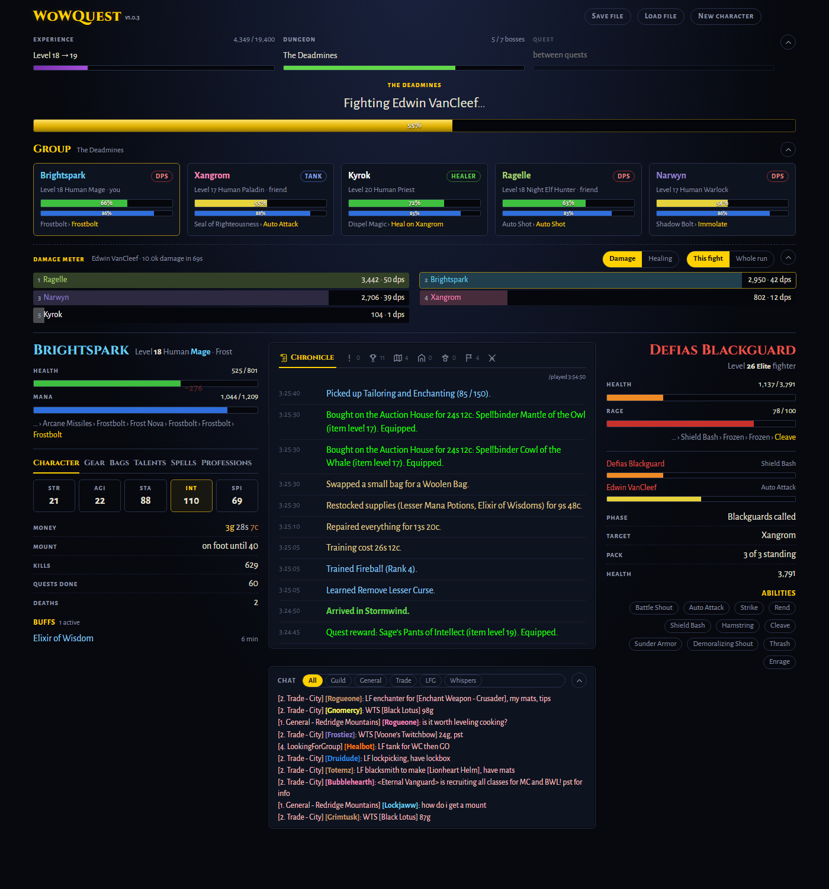
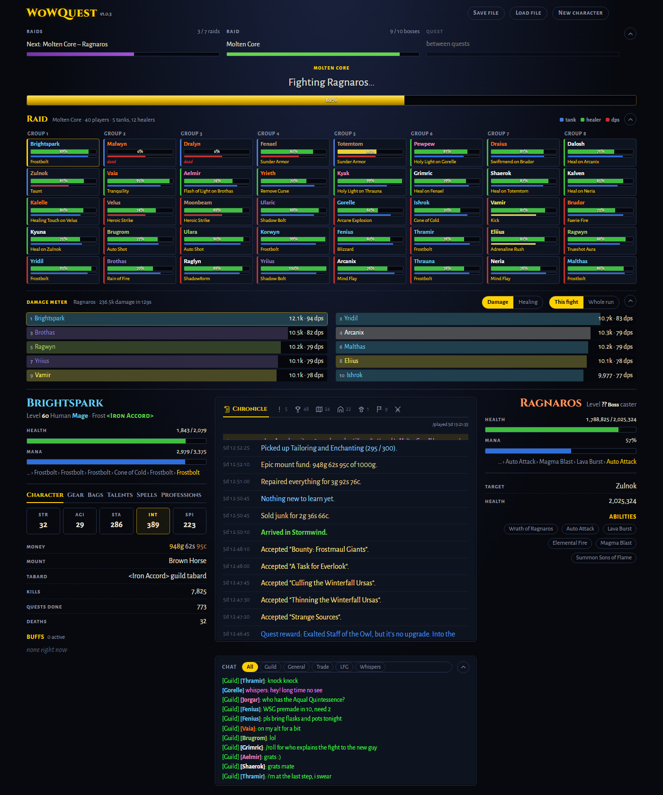

# WoWQuest

An idle tribute to classic World of Warcraft. Create a character, then watch them live a whole vanilla life on their own: questing from level 1 to 60, running dungeons with friends, joining a guild, and raiding from Molten Core to Naxxramas. Like the real thing, levelling takes about **five days** of play time, and the raid content after that takes months.

## ▶ [Play it in your browser](https://carrandas.github.io/WoWQuest/)

## How it works

1. **Create a character.**
   - **Faction:** Alliance or Horde
   - **Race:** each faction's four classic races
   - **Class:** the nine classic classes, with the original race and class combinations
   - **Talent tree** and **professions**
2. **Watch the classic levelling loop:**
   - Arrive in a zone, pick up quests at the hub, kill and collect out in the field, turn in, move on.
   - **Every two levels,** go to your capital to train spells, buy gear on the Auction House, repair and restock.
   - **Dungeons** with a group (friends you made along the way, or strangers from LookingForGroup), from Ragefire Chasm and the Deadmines to Scholomance and Stratholme.
3. **Life at 60:**
   - Pre-raid gear, attunements, then raiding with your guild
   - Goals you pick, like a legendary, a mount, a reputation or the Gurubashi Arena
   - Holidays and world events as they come around

Your character keeps playing (at normal speed, for up to 12 hours) while the tab is closed.

## Features

**Levelling**
- 43 classic zones with their quest hubs, monsters and quests, in the order of each race's real levelling route
- Class spells at their real trainer levels, talents, and the class quests that held spells back: Bear Form, the warlock's demons, the shaman's totems, Tame Beast, Defensive Stance and more
- Professions with gathering, crafting, the Auction House, enchants, and fishing as a third secondary skill
- World PvP in the contested zones, minipets and mounts to collect, and achievements for nearly everything

**Dungeons and raids**
- 23 dungeons and 7 raids in release order, with their bosses, signature loot, lockouts and Tier 0 to Tier 3 sets
- Group and raid frames, a damage and healing meter, and boss fights that are actually played out. Tanks swap, healers run out of mana, a druid battle rezzes, and the chronicle says who died to what.
- Attunement quest chains, resistance as a real stat (Sapphiron is a wall without frost gear) and the Onyxia Scale Cloak against Nefarian
- The Gates of Ahn'Qiraj with the war effort and the Scarab Gong, the Scourge Invasion before Naxxramas, and world bosses (Azuregos, Kazzak, the Emerald Dragons)

**At 60**
- The pre-raid dungeon set from its real bosses, and Dungeon Set 2 (Tier 0.5)
- Legendaries as their real quest chains: Thunderfury (with Prince Thunderaan), Sulfuras and Atiesh, plus the class weapons Rhok'delar, Benediction and Quel'Serrar, and the paladin and warlock epic mounts
- Reputation grinds (Timbermaw Hold, the Hydraxian Waterlords, the Zandalar Tribe, the Argent Dawn, the Thorium Brotherhood, the Darkmoon Faire), farming runs and daily transmutes
- Battlegrounds and the PvP ranks, up to the rank 14 grind

**The world around you**
- An in-game calendar with the Darkmoon Faire every month and the holidays (Hallow's End, Winter Veil, the Lunar Festival and more), each with its own prizes and pets
- Friends and a guild with personalities: guild chat, DKP, server firsts against a rival guild, and guild drama (the loot council, the main tank leaving, the guild leader yelling on voice chat)
- A chat panel with General, Trade, LookingForGroup, Guild and whispers ("Where is Mankrik's wife?")

**Under the hood**
- No install and no build step: plain HTML, CSS and JavaScript, served straight from GitHub Pages
- Progress saves automatically in your browser, plus save files to download and load

Tap the logo five times for a little surprise.

## Run it locally

Download or clone the repository and open `index.html` in any modern browser.

---

*A fan-made tribute. Not affiliated with or endorsed by Blizzard Entertainment. World of Warcraft and related names are trademarks of Blizzard Entertainment, Inc.*
