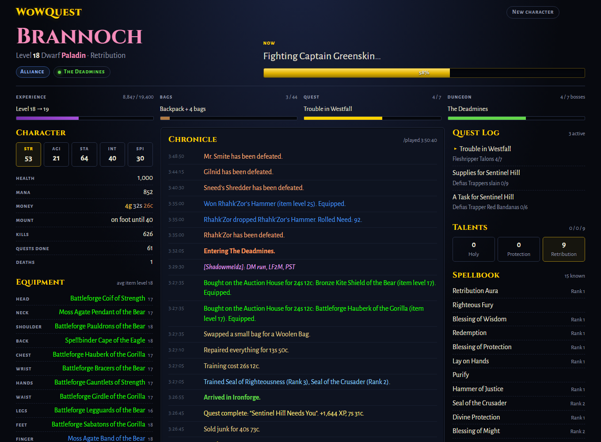

# WoWQuest

An idle tribute to levelling in classic World of Warcraft. Create a character, then watch them go from level 1 to 60 on their own: questing through the classic zones, training spells, buying gear and running dungeons. Like the real thing, the whole journey takes about **five days** of play time.

## ▶ [Play it in your browser](https://carrandas.github.io/WoWQuest/)

## How it works

1. **Create a character.**
   - **Faction:** Alliance or Horde
   - **Race:** each faction's four classic races
   - **Class:** the nine classic classes, with the original race and class combinations
   - **Talent tree**
2. **Watch the classic levelling loop:**
   - Arrive in a zone and pick up quests at the quest hub.
   - Kill and collect out in the field until the bags are full or the quests are done.
   - Go back to the hub to sell junk, turn in quests and pick up new ones.
   - **Every two levels,** go to your capital (Stormwind, Ironforge, Darnassus, Orgrimmar, Undercity or Thunder Bluff). There you train new spells and ranks, buy gear on the Auction House, repair, and head to the next zone.
   - **Dungeons:** run the one that fits your level, from Ragefire Chasm and the Deadmines all the way to Scholomance and Stratholme.
3. **Milestones:**
   - Level 10: talent points
   - Level 40: your first mount, and plate or mail for some classes
   - Level 60: Molten Core, Onyxia, and saving up 1000 gold for an epic mount

Your character keeps playing (at normal speed, for up to 12 hours) while the tab is closed.

## Features

- About 40 classic zones along each race's real levelling route, with their quest hubs, monsters and quests
- Class spells learned at their real trainer levels, with ranks that go up as you level
- 23 dungeons and 2 raids, with their bosses and signature loot
- Gear by item level and quality (grey, white, green, blue and purple), plus dungeon and tier sets
- No install or build step: the whole game is one `index.html` file
- Progress saves automatically in your browser

Tap the logo five times for a little surprise.

## Run it locally

Download `index.html` and open it in any modern browser.

---

*A fan-made tribute. Not affiliated with or endorsed by Blizzard Entertainment. World of Warcraft and related names are trademarks of Blizzard Entertainment, Inc.*
